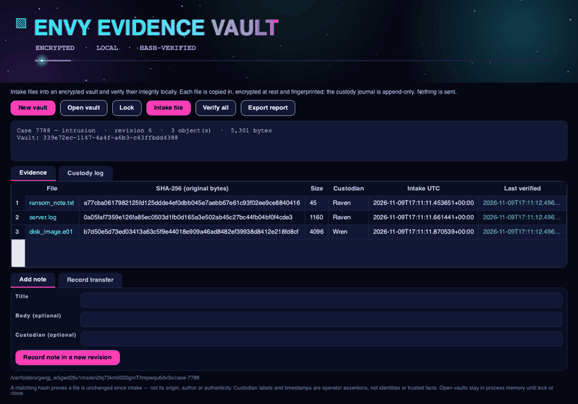
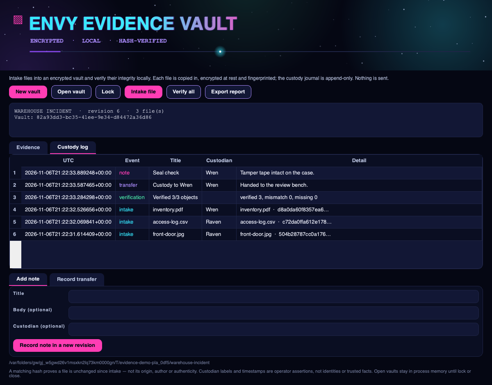

<p align="center">
  
</p>

<p align="center"><b>Collect files into an encrypted vault and prove they stay unchanged — copied-file intake, SHA-256 fingerprints and a hash-chained custody journal — in a real native app window.</b><br />
Files copied in and encrypted at rest, verification that re-hashes every object, custody transfers and notes, and plaintext export. From ENVY BLACK VEIL, as a standalone app.</p>

<p align="center">
  <a href="https://github.com/xzchick/envy-evidence-vault/actions/workflows/tests.yml"></a>
</p>
<p align="center">
  
  
  <br />
  
  
  
  
</p>

<p align="center">
  <a href="#install"><b>Install</b></a> ·
  <a href="#works-on">Compatibility</a> ·
  <a href="#using-it">Using it</a> ·
  <a href="#honest-by-design">What it isn't</a> ·
  <a href="#build--test">Build</a>
</p>

<p align="center">
  
</p>

<p align="center"><sub>A real native window — not a browser view. The title pulses, the stars twinkle, and a light travels the accent bar.</sub></p>

<a name="features"></a>




Create an encrypted vault, then **intake** files: each is copied into the vault's object store, **encrypted at rest**, and keyed by the **SHA-256 of its original bytes** — the fingerprint that goes in the manifest. **Verify** decrypts every stored object and re-hashes it, reporting *verified*, *mismatch* or *missing*. Every intake, verification, custody **transfer** and **note** is appended to a **SHA-256 hash-chained journal**, so the record is tamper-evident and nothing is overwritten.

<p align="center">
  
</p>

A matching hash proves one thing precisely: the file is **unchanged since intake**. It does not establish where the file came from, who made it, or that it is genuine — and the window says so.

<a name="works-on"></a>


<p align="center">
  
  
  
</p>



### Requirements

| | 🍎 macOS | 🪟 Windows | 🐧 Linux |
|---|---|---|---|
| **OS version** | macOS 11 Big Sur or newer | Windows 10 or 11 (64-bit) | A current x86_64 or arm64 desktop |
| **Standalone bundle** | Nothing else to install | Nothing else to install | Standard desktop libraries (X11 or Wayland) |
| **From pip** | Python 3.10+ | Python 3.10+ | Python 3.10+ and a desktop session |
| **Dependencies** | `cryptography` + Qt (bundled) | `cryptography` + Qt (bundled) | `cryptography` + Qt (bundled) |
| **Network** | None, ever | None, ever | None, ever |

<a name="install"></a>


A **standalone bundle** that needs no Python, or **pip** if you already have Python 3.10+.

### Standalone bundle (no Python)

Download a bundle from the [latest release](https://github.com/xzchick/envy-evidence-vault/releases/latest):

| File | System | Run it |
|---|---|---|
| `envy-evidence-vault-v0.1.0-macos-arm64.tar.gz` | macOS (Apple Silicon) | `tar -xzf` it, then open `envy-evidence-vault` |
| `envy-evidence-vault-v0.1.0-windows-x86_64.zip` | Windows (64-bit) | Unzip, then run `envy-evidence-vault.exe` |
| `envy-evidence-vault-v0.1.0-linux-x86_64.tar.gz` | Linux (64-bit) | `tar -xzf` it, then run `./envy-evidence-vault` |
| `envy_evidence_vault-0.1.0-py3-none-any.whl` | Any OS with Python 3.10+ | `pip install` the wheel |
| `SHA256SUMS.txt` | — | Verify your download first |

Running `envy-evidence-vault` with no arguments opens the window.

### Homebrew (macOS, Apple Silicon)

```sh
brew install --cask xzchick/envy/envy-evidence-vault
```

These builds aren't notarized, so if macOS blocks it on first run, add `--no-quarantine` to that command. Intel Macs, Linux and Windows: use the standalone bundle above.

### From pip (Python 3.10+)

```sh
git clone https://github.com/xzchick/envy-evidence-vault.git
cd envy-evidence-vault
python3 -m venv .venv
. .venv/bin/activate          # Windows: .venv\Scripts\activate
pip install .
envy-evidence-vault            # opens the window
```

<a name="using-it"></a>


**In the window**

- **New vault** → name the case, choose an empty directory and a passphrase (at least 12 characters).
- **Intake file** → pick a file; it is copied in, encrypted at rest and fingerprinted, with an optional custodian label and note.
- **Verify all** → re-hashes every stored object and reports verified / mismatch / missing, logging the result.
- Use **Add note** or **Record transfer** for custody events. The **Evidence** and **Custody log** tabs show the current files and the full journal.
- **Export report** writes a plaintext HTML or JSON copy — it is *not* encrypted.

**In the terminal**

```sh
envy-evidence-vault new case/ --title "Warehouse incident"
envy-evidence-vault intake case/ ./front-door.jpg --custodian Raven
envy-evidence-vault verify case/                     # re-hash every object
envy-evidence-vault transfer case/ --custodian Wren --note "Handed to review"
envy-evidence-vault export case/ report.html --format html
```

The manifest is updated atomically and the custody journal is append-only; intaken objects and exports are never overwritten.

<a name="honest-by-design"></a>


The encryption is real: the manifest and every stored object are sealed with **AES-256-GCM** and a key derived from your passphrase with **scrypt**, the same envelope [ENVY Vault](https://github.com/xzchick/envy-vault) uses. What Evidence Vault does **not** do is just as important:

- **A hash proves integrity, not origin.** A match means the bytes are unchanged since intake. It says nothing about where the file came from, who made it, or whether it is authentic.
- **Custodian labels are not identities.** A custodian or transfer is a label you typed; it authenticates no one.
- **Timestamps are your machine's assertions.** Intake and verification times come from your clock; the hash chain does not establish a trusted time.
- **A plaintext export is plaintext.** Store and handle it under your own policy.
- **Nothing is sent.** No messages, no network. Open vaults stay in process memory until you lock or close; Python cannot guarantee memory erasure.

> [!IMPORTANT]
> Keep your passphrase safe. There is no recovery: without it, the manifest and the encrypted objects cannot be opened.

<a name="build--test"></a>


```sh
python -m unittest discover -s tests -v          # unit tests (no display needed)
pip install pyinstaller build
python scripts/build_release_bundle.py           # standalone bundle + wheel + sdist + checksums
python scripts/smoke_test_release.py             # launch the built bundle and check it runs
```

CI runs all of this on Ubuntu, Windows and macOS for every push. Regenerate the README artwork with `python scripts/render_readme_art.py`.

<p align="center"><sub>MIT licensed. Part of ENVY BLACK VEIL, packaged as a standalone app. Offline; no telemetry, no network, no accounts.</sub></p>
